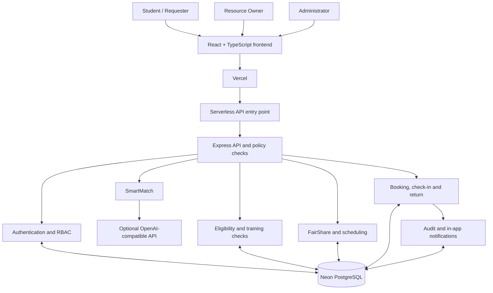

# CampusShare X

<p align="center">
  <strong>The trust layer for shared resources.</strong><br/>
  A safety-aware resource-sharing platform for universities, laboratories, research teams and makerspaces.
</p>

<p align="center">
  <a href="https://campus-share-x.vercel.app">Live application</a> ·
  <a href="https://campus-share-x.vercel.app/api/health">API health</a> ·
  <a href="https://github.com/pradyumna0222/CampusShare-X">Source repository</a>
</p>

---

## Overview

Universities and research institutions often have equipment and spaces that are idle for long periods, while students and project teams struggle to access them. A basic booking calendar does not solve the harder problems: user eligibility, mandatory training, competing requests, fair allocation, equipment handover, damage reporting and accountability.

**CampusShare X** manages the resource-sharing lifecycle in one application. It helps users discover relevant resources, checks whether they are eligible to request them, lets authorised owners review bookings, records check-in and return conditions, and preserves an auditable history of important actions.

The application is deployed at **https://campus-share-x.vercel.app**.

## Product highlights

| Capability | What it does |
|---|---|
| **SmartMatch** | Matches a natural-language project goal to catalogue capability tags, ranks relevant resources and explains the match. |
| **TrustGuard** | Enforces account verification and resource-specific training requirements on the server. |
| **FairShare** | Applies a limit of three active/upcoming reservations per user, checks schedule conflicts and supports transparent waitlisting. |
| **Resource Passport** | Brings resource details, operating requirements and booking lifecycle context together, including before/after condition records. |
| **Audit history** | Records key actions and decisions, with role-authorised activity views and CSV export. |

### End-to-end workflow

1. An authorised owner lists a resource and defines its location, conditions, status and required training.
2. A student discovers resources through search or SmartMatch.
3. The student reviews the resource requirements and selects a date and time.
4. The server checks account verification, training eligibility, booking limits, conflicts and maintenance blocks.
5. The owner reviews the request and approves, rejects or waitlists it with a decision reason.
6. An authorised user checks the resource out and records its initial condition.
7. The resource is returned and its final condition is recorded.
8. A non-good return condition can open an incident for an authorised person to review.
9. Booking, handover, return and incident actions remain available in the relevant activity history.

> SmartMatch provides recommendations only. It does not grant permission, certify training or guarantee a time slot. Access and safety decisions are validated by the backend and remain under authorised human control.

## User roles

- **Student / requester:** discovers resources, checks requirements, requests bookings, checks resources out and records returns.
- **Resource owner:** manages owned resources, operating status and maintenance blocks; reviews booking and extension requests; handles incidents.
- **Administrator:** reviews account verification, manages authorised roles and training records, and inspects permitted institutional activity.

Role and ownership permissions are enforced by the API, not just by hiding controls in the interface.

## Technology stack

| Layer | Technologies |
|---|---|
| Frontend | React 18, TypeScript, Vite, CSS, Lucide React |
| Backend | Node.js 24-compatible runtime, Express.js REST API |
| Production database | Neon managed PostgreSQL, `pg` connection pool, versioned SQL migrations |
| Local/test database | PGlite embedded PostgreSQL fallback |
| Deployment | Vercel frontend build and serverless API |
| Authentication | bcryptjs password hashing, opaque session tokens stored as hashes, HTTP-only cookies |
| Security | Helmet, authentication rate limiting, parameterised SQL, input validation, role and ownership checks |
| Optional AI | OpenAI-compatible Chat Completions API for constrained SmartMatch capability extraction |

### SmartMatch AI workflow

SmartMatch starts with a user's project description. The backend obtains the catalogue's allowed capability tags and derives candidate tags from the request. If `OPENAI_API_KEY` is configured, the application can optionally send the goal and allowed-tag list to an OpenAI-compatible Chat Completions endpoint. The model is instructed to return structured JSON and use only the supplied tags.

The server validates returned tags against the allowlist, scores catalogue resources by capability-tag relevance and supplies match explanations. If the AI provider is not configured or returns an error, deterministic rule-based tag extraction is used. The model does not make eligibility, safety, access or availability decisions.

## Architecture



In production, Vercel serves the frontend and routes `/api/*` requests to `api/index.js`. The serverless entry point initialises the SQL migrations and seed process before passing the request to the Express application. Neon PostgreSQL stores application data. PGlite is available for local testing when no external `DATABASE_URL` is provided.

## Getting started locally

### Prerequisites

- Node.js **22.15 or later** (Node.js 24 recommended)
- npm 10 or later
- Git

### Install and run

Run these commands from the project root (the folder containing `package.json`):

```powershell
# Install dependencies
npm install

# Create your local environment file
Copy-Item .env.example .env

# Open .env and choose one database option:
# 1. For zero-configuration local testing, clear DATABASE_URL so it is empty.
#    The app will use embedded PGlite.
# 2. To use PostgreSQL/Neon, set DATABASE_URL to your own connection string.

# Apply database migrations
npm run migrate

# Start the API and Vite development server
npm run dev
```

Open **http://localhost:5173** in your browser. Vite proxies `/api` requests to the Express API.

For a persistent local PGlite data directory, you can set `PGLITE_DATA_DIR=./pgdata` in `.env`. The `pgdata` directory is ignored by Git.

### Available commands

```powershell
npm run dev         # Start Express API and Vite frontend
npm run dev:api     # Start the API only (watch mode)
npm run dev:web     # Start Vite frontend only
npm run migrate     # Apply SQL migrations
npm test            # Run automated API tests
npm run typecheck   # Run TypeScript project checks
npm run build       # Build the production frontend
npm start           # Start the Express server
npm run preview     # Preview the built frontend
```

## Environment configuration

Copy `.env.example` to `.env` for local development. Important variables include:

| Variable | Purpose |
|---|---|
| `DATABASE_URL` | PostgreSQL connection string. Leave empty for the local PGlite fallback. |
| `DATABASE_SSL` | Enables SSL configuration where applicable. |
| `DB_POOL_MAX` | PostgreSQL connection-pool size. |
| `NODE_ENV` | Set to `production` in the production environment. |
| `APP_TIMEZONE` | Application display/business timezone. |
| `BOOKING_TIMEZONE_OFFSET_MINUTES` | Booking timezone offset; `330` represents UTC+05:30. |
| `SEED_INITIAL_ACCOUNTS` | Allows initial production account seeding when enabled. |
| `SEED_INITIAL_RESOURCES` | Allows the initial sample resource catalogue to be seeded. |
| `INITIAL_*_EMAIL` | Email identifiers for initial demo accounts. |
| `INITIAL_*_PASSWORD` | Initial passwords; use unique, strong values outside local development. |
| `OPENAI_API_KEY` | Optional key for SmartMatch LLM enrichment. |
| `OPENAI_BASE_URL` | Optional OpenAI-compatible API base URL. |
| `OPENAI_MODEL` | Optional model name; the configured default is `gpt-4.1-mini`. |

**Never commit `.env`, real database URLs, API keys, production passwords, database dumps or private user data.** The `.gitignore` excludes `.env` files and local database data. `.env.example` contains sample-only values; replace the example database URL or clear it for local PGlite use.

### Production account seeding

Production initial accounts are created only when the database has no users. After the first seed, changing `INITIAL_*_PASSWORD` in Vercel does **not** reset existing account passwords. Existing production account passwords must be changed through a separate secure password-management procedure.

Demo account passwords are intentionally not published in this repository. Share judge credentials only through a private channel approved by the organisers. For simultaneous role demonstrations, use separate browser profiles: tabs in the same browser profile share the same session cookie.

## Deploying with Vercel and Neon

The current production deployment uses **Vercel + Neon PostgreSQL**.

1. Create or select a Neon PostgreSQL project.
2. Copy the Neon **pooled** connection string and keep it private.
3. In the Vercel project, open **Settings → Environment Variables**.
4. Add `DATABASE_URL` with the new Neon pooled connection string. Set `NODE_ENV=production`, timezone settings and unique initial account values as required by the seed code.
5. Keep `OPENAI_API_KEY` optional unless the external SmartMatch model is configured and tested.
6. Redeploy the Vercel project after changing production environment variables.
7. Check the API health endpoint and test student, owner and administrator workflows.

- Application: https://campus-share-x.vercel.app
- API health: https://campus-share-x.vercel.app/api/health

Do not use a connection string or password that has previously been exposed. Rotate any exposed secret before production use. Never put Vercel environment values into this README or a public commit.

## Testing

Run the checks from the project root:

```powershell
npm test
npm run typecheck
npm run build
```

The API test suite is designed to cover:

- Health checks, unauthorised access and authentication.
- Role-based access and administrator functions.
- Training eligibility for restricted resources.
- Booking requests, owner decisions, waitlisting and conflict prevention.
- FairShare reservation limits.
- Check-in, extension requests, return-condition reporting and incident resolution.
- Maintenance blocks, training verification and audit CSV export.
- Data persistence across database pool reconnection.

For a full manual acceptance test, rehearse one complete journey: owner lists a resource → student discovers and requests it → owner approves → student checks it out → student returns it → owner reviews any incident → authorised user inspects the audit history.

Do not report a manual test as passed until it has been run against the current deployed version.

## Known limitations

- The initial resource catalogue and seeded identities are illustrative sample data, not a verified institutional inventory.
- The external SmartMatch LLM is optional. Deterministic rule-based matching is the fallback.
- Notifications are stored and shown in-app; outbound email, WhatsApp and SMS delivery are not connected.
- Condition reports are text-based. Photo upload and image comparison are future work.
- FairShare is a transparent rule-based policy; the project does not claim a measured fairness improvement or machine-learning allocation optimisation.
- Institution-specific single sign-on, trusted training integrations, deposits, supervised-use schedules and multi-campus governance need further work.
- The application has not been penetration-tested or approved for sensitive institutional records or unrestricted real-world access to dangerous equipment.

## Repository structure

```text
api/
  index.js                  Vercel serverless API entry point
server/
  index.js                  Express application and API routes
  db/
    index.js                PostgreSQL pool and PGlite fallback
    migrate.js              SQL migration runner
    seed.js                 Initial accounts and sample resources
    migrations/             Versioned PostgreSQL schema migrations
src/                        React + TypeScript frontend
tests/
  api.test.js               Automated API integration tests
  MANUAL_ACCEPTANCE_TESTS.md
docs/
  ARCHITECTURE.md
  PROJECT_REPORT.md
  TEST_PLAN.md
vercel.json                 Vercel build and API routing configuration
```

## Project and contribution

**Project:** CampusShare X  
**Contributor:** RAMADURGAM PRADYUMNA (sole individual contributor)

AI-assisted tools were used during project planning, code generation, debugging and refinement. The optional SmartMatch LLM integration is a separate runtime feature and is not required for deterministic matching. Any hackathon submission should disclose AI assistance, libraries, frameworks and pre-existing components in accordance with the event rules.

## License

See the [`LICENSE`](LICENSE) file for the repository's license terms.
