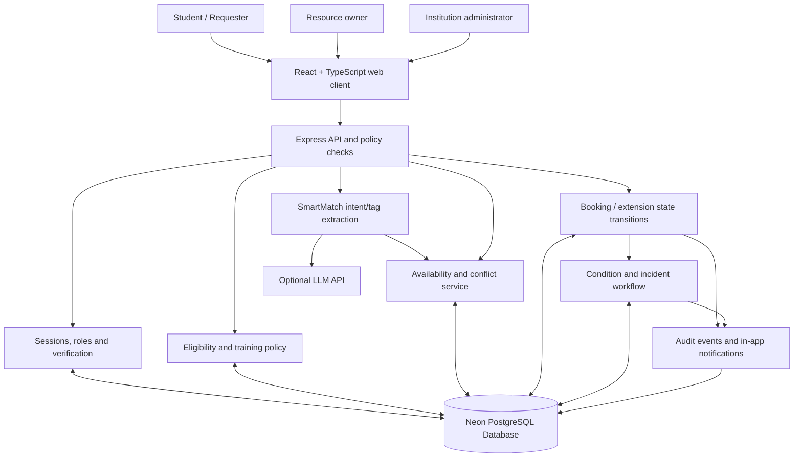

# CampusShare X — Architecture

## Deployment topology

## Boundaries and trust model

- The browser presents data and collects commands; it is not the authority for role, training or availability.
- Express authenticates requests with a server-managed cookie and derives the current user from the stored session.
- The API validates every high-impact transition and verifies resource ownership for owner routes.
- PostgreSQL (hosted on Neon Serverless PostgreSQL) stores resources, bookings, condition records, extensions, incidents, notifications, training records and audit events.
- SmartMatch optionally calls an external LLM to extract tags from the user's goal. Only catalogue-allowed tags are accepted. If the provider fails, deterministic extraction is used. The LLM does not determine policy, safety or availability.
- Date-specific availability is a snapshot for user awareness. The create/approval endpoints repeat conflict and policy checks inside database transactions with row-level locks (`SELECT ... FOR UPDATE`), preventing race conditions.

## Main state transitions

Booking: `pending -> approved | rejected | waitlisted`; `waitlisted -> pending | rejected | cancelled`; `approved -> checked_out | cancelled`; `checked_out -> returned`. Cancellations and extensions are recorded as separate events. The application rejects invalid transitions at the API.

Extension: `pending -> approved | rejected`. Approval updates the effective end time only after rechecking booking state, duration and conflicts.

Incident: `open/in_review -> resolved` by a resource owner or administrator; resolution requires a note and creates an audit event. The system does not automatically infer responsibility.

## Data persistence

Data is persisted in Neon Serverless PostgreSQL using versioned SQL migrations (`server/db/migrations/`).
Connection pooling is managed via `pg.Pool` with SSL encryption enabled.
For local offline runs and CI without external dependencies, embedded PostgreSQL (`@electric-sql/pglite`) acts as a drop-in local database engine.

## Security design

- Bcrypt password hashes and opaque random session tokens persisted only as SHA-256 hashes in PostgreSQL.
- HTTP-only, SameSite session cookie; Secure flag in production.
- Auth rate limiting; Helmet headers; limited JSON body size.
- Parameterized SQL (`$1, $2, ...`) and server-side input validation preventing SQL injection.
- Role checks, owner checks and verified training checks.
- Production same-origin guard on mutating requests when an Origin header is present.
- Audit list routes do not expose edits/deletes to past events through normal application actions.
- Safe idempotent seeding that rejects default development passwords in production deployments.
